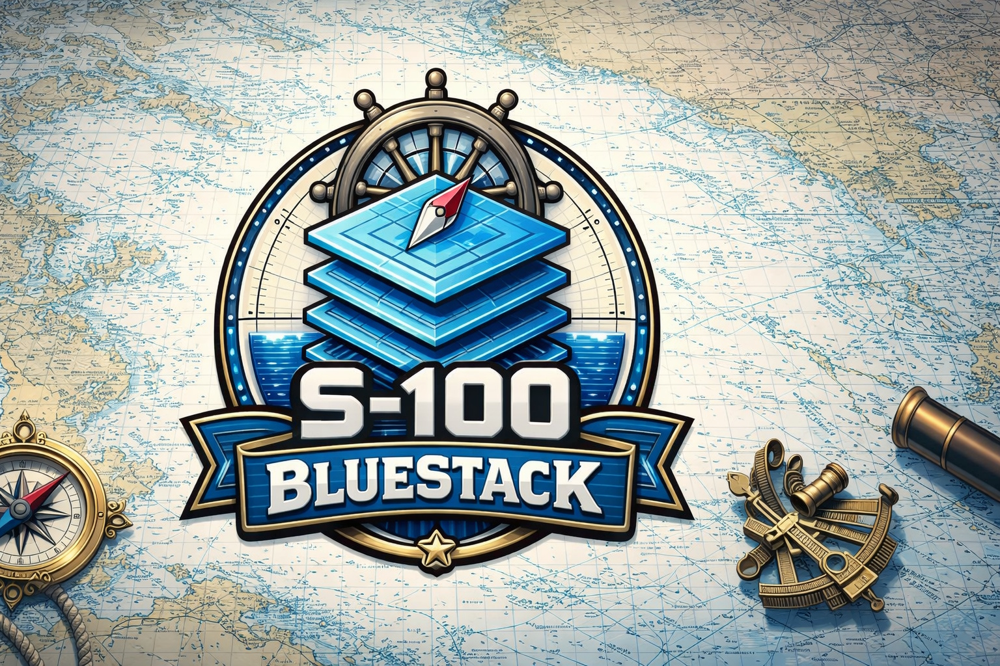

# S-100 Framework
*… are you ready to join together ?*




## Project Overview:

The project aimed to implement the S-100 standard within ArcGIS Pro to improve the creation, management, and dissemination of electronic navigational charts (ENCs) in compliance with the International Hydrographic Organization's (IHO) S-100 framework. The implementation of S-100 standards in ArcGIS Pro facilitates the transition from traditional paper charts to modern digital navigational tools, enhancing safety and efficiency in maritime navigation.

## Key Objectives:

1. **Compliance with S-100 Standards and Specifications**\
**Expectation:** *The production system must fully apply to the S-100 framework, ensuring that all datasets conform to the required feature catalogs, metadata structures, and exchange formats.*\
**Reasoning:** *Compliance guarantees interoperability with other S-100-based systems, supports standardization in hydrographic data production, and ensures regulatory alignment.*

2. **Scalability and Flexibility for Multi-Domain Support**\
  **Expectation:** *The system should be capable of producing and managing datasets across multiple S-100 standards, such as S-101 (ENCs), S-122 (Marine Protected Areas), S-125 (Marine Aids to Navigation), and S-132 (Marine Harbour Infrastructure) etc.*\
  **Reasoning:** *As hydrographic offices and maritime stakeholders adopt S-100, the system must handle diverse data types efficiently while allowing for future expansions and standard updates.*

3. **Automation and Efficient Workflow Management**\
  **Expectation:** *The system should support automation in data validation, transformation, and distribution to minimize manual effort and improve efficiency.*\
  **Reasoning:** *Automated workflows help reduce errors, accelerate production timelines, and ensure that updates and corrections are implemented consistently across datasets.*

4. **Seamless Data Exchange and Interoperability**\
  **Expectation:** *The system must facilitate seamless data exchange between hydrographic offices, maritime authorities, and end-users, supporting secure and standardized delivery methods.*\
  **Reasoning:** *Effective interoperability ensures that produced datasets can be integrated into Electronic Chart Display and Information Systems (ECDIS), Geographic Information Systems (GIS), and other maritime applications without compatibility issues.*


## Project Structure

`S100Services` is a multi-application repository, not the generic
`Application/Core/Infrastructure/UI` folder layout used in an earlier version of
this README. At the 2026-11-10 documentation snapshot (`63c89ff0`), the tracked
source and test directories include:

```text
src/
  DataCatalogue/
  DataCatalogueAPI/
  JobManager/
  ProductCatalogue/
  ProductCatalogueAPI/
  ProductManagerCore/
tests/
  DataCatalogueAPI.Tests/
  EncMetadataTopology/
  EncRecovery/
  ProductHistory/
  TestProductCatalogue/
  TestProductManager/
```

This is a directory inventory, not a claim that every project is deployed or
that its runtime contracts are interchangeable. Read the repository
[`AGENTS.md`](AGENTS.md), the selected application's `AGENTS.md`, and its current
README and architecture documentation before changing code. Use the explicit
Git baseline from the task rather than assuming this inventory is always current.

## Contacts
Jens Søe Christiansen jesoe@gst.dk
